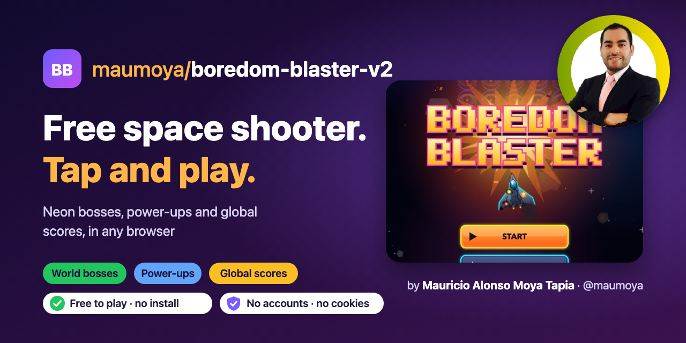
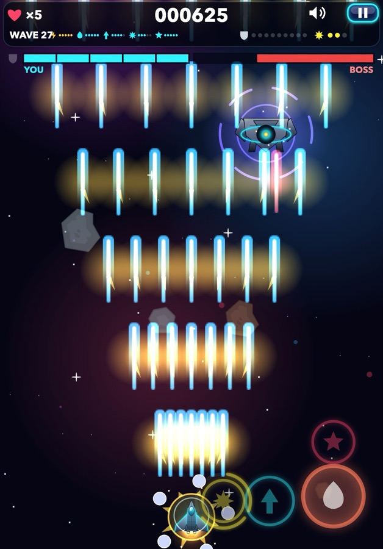
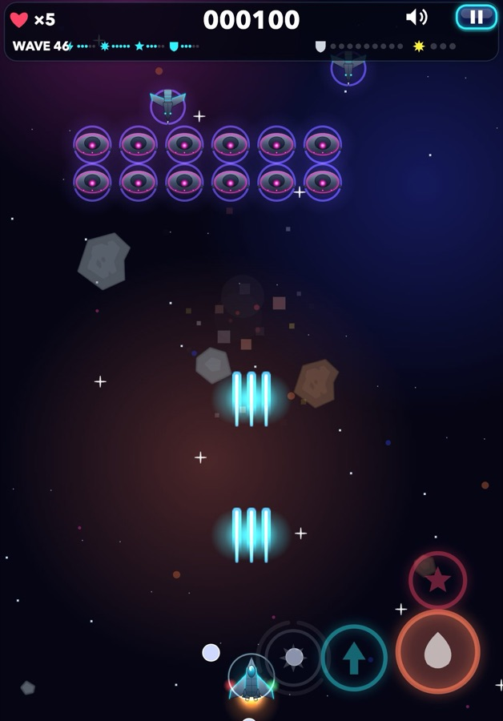
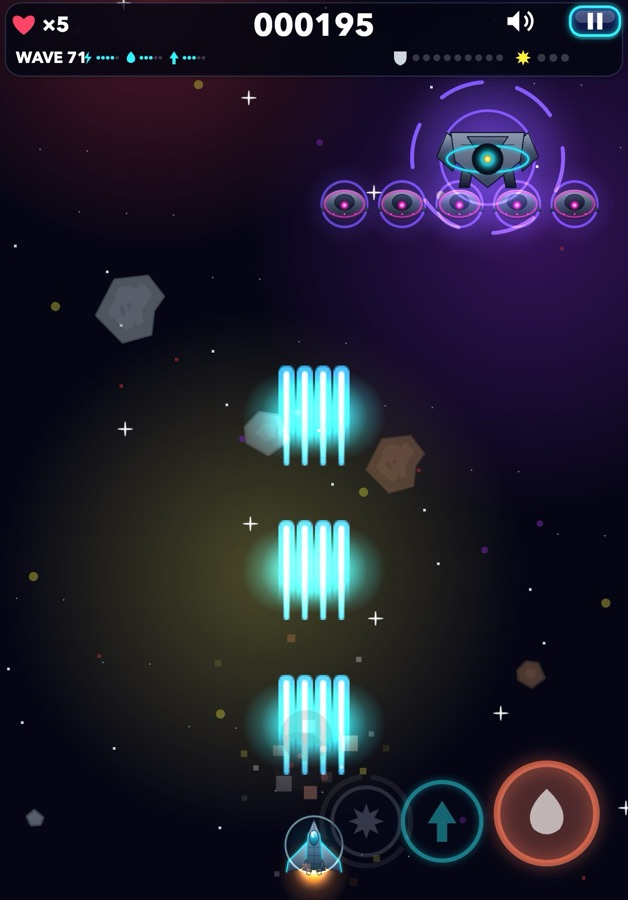

  

  
  

  
  
  
  
  
  
  
  

# Boredom Blaster

**A fast, neon space shooter that runs in any browser.** Steer, power up, beat the bosses and climb a
global high-score table that cannot be faked. Free, no install, no sign-up.

  
  
  

| 5 worlds | 7 weapon families | 338 tests | $0 |
|:---:|:---:|:---:|:---:|
| 100 waves each, then it loops harder | up to ULTRA-MAD | game rules, input, score server, anti-cheat | to host and run |

## The game

- **Pick your build.** Seven upgrade families (more shots, faster shots, lasers, orbiting moons, a magnet and more), each climbing to MASTERED and ULTRA-MAD.
- **Bosses and worlds.** Five enemy types and two mini-bosses on curved entry paths, across five worlds with their own sky, colors and music.
- **Play anywhere.** Thumb stick and buttons on the phone, a left-hand mode, remappable keyboard keys, and game controller support.

## How it is built

Written from scratch in plain JavaScript and the HTML canvas, with no game engine or framework.
Static hosting on GitHub Pages, plus one small Cloudflare Worker for the shared scores.

- **A score table that refuses fakes.** Every run gets a signed ticket from the server (HMAC with the server's clock). A score is accepted only with a valid, unused ticket, and only if its waves, play time and points fit the real time that passed. Practice runs never post.
- **Privacy first.** No accounts, no cookies, no IDs. The only stats are anonymous counts of finished runs. Only three initials are kept with a score.
- **Always the newest version.** `index.html` reads `version.json` uncached and loads every script with the game's commit as its version, so a normal reload gets the latest build.

Stack: JavaScript · HTML Canvas · Web Audio · Gamepad API · Cloudflare Workers + KV · GitHub Pages · `node:test`.
The full write-up, with screens and the score flow end to end, is on the [portfolio page](https://maumoya.github.io/boredom-blaster-v2/portfolio/).

## This repository

This is the published build. `tools/publish.sh` copies the game from its source repository,
regenerates `index.html` and `version.json`, and pushes; GitHub Pages serves the result.
It also carries the tests (`test/`, run with `node --test`) and the scores Worker (`worker/`).

## Contributing and security

See [CONTRIBUTING.md](CONTRIBUTING.md). Report vulnerabilities privately as described in [SECURITY.md](SECURITY.md).

## Credits

Designed and developed by **Mauricio Alonso Moya Tapia** ([@maumoya](https://github.com/maumoya)). Released under the [MIT License](LICENSE).
More of my work on [GitHub](https://github.com/maumoya); say hi on [LinkedIn](https://www.linkedin.com/in/mba-mmoyat/).

Ship and enemy sprites: "Space Shooter Redux" by Kenney ([kenney.nl](https://www.kenney.nl)), CC0.
